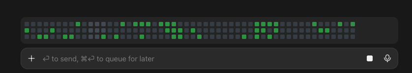

# pixel-progress

A retro, classic pixel-grid progress bar for Claude Code: 8-bit style squares in the look of GitHub's contribution graph. While Claude works, a 3-row grid of small squares appears above the prompt. Squares light up as plan steps are completed, and the whole grid turns green when the work finishes.


The animation shows a 4-step plan from start to finish: the empty grid with its blinking cursor, squares flashing in as each step completes, and the retro wave of light that sweeps across when the answer is done. It is rendered frame by frame from the mod's own drawing rules.



## What it shows

- **Idle:** nothing.
- **Working:** a grid as wide as the prompt. Squares fill in random order as plan steps complete (`done / total`).
  - Newly filled squares flash bright, then settle into their green.
  - Squares for the step in progress glow softly beyond the filled ones.
  - A blinking white square marks the next one, and a faint shimmer sweeps the empty squares.
- **Finished:** every square turns green and a soft diagonal wave of light with a fading tail sweeps across over about 3 seconds. The grid disappears after about 5 seconds.
- **Interrupted or failed:** the bar hides instead of showing the success state.

## Previews

Illustrations drawn with the mod's own colors and spacing, not captures of a live session (the screenshot above is a real capture).

| State | Preview |
| --- | --- |
| Plan started: the first step glows, the next square blinks white |  |
| Half done: new squares flash |  |
| Finished: the wave sweeps across |  |
| Finished: settled |  |

## Themes

Set `theme` in the plugin's config (`/config`, or `pluginConfigs` in `settings.json`): `github` (default), `ocean`, `sunset` or `neon`.

| Theme | Preview |
| --- | --- |
| `github` |  |
| `ocean` |  |
| `sunset` |  |
| `neon` |  |

## How progress is measured

The fill is the share of plan steps marked completed, taken from Claude's task list (`TodoWrite`, or the Claude desktop app's plan tool). It is not an estimate.

- If Claude has not made a plan, the grid stays empty (only the blinking square shows) because there is nothing real to measure. When the answer finishes, the grid still fills completely, plan or not.
- Rounding never fakes the ends: a plan that is not complete never shows a full grid, and a plan with any completed step shows at least one square.
- It reflects steps, not time. A long step keeps the bar still until it completes.
- Only the main session's plan counts. A subagent's own task list is ignored, so it cannot change the bar.

## Surfaces

In the Claude desktop app the grid is drawn as an SVG sized to about the width of the prompt, with the same gap between rows and between columns. In a terminal it is drawn with `■` characters, so the row spacing there is one text line.

## Install

At the prompt of a Claude Code terminal session:

```
/plugin install pixel-progress --marketplace nitin23c/pixel-progress
```

Answer `y` to add the marketplace, then pick a scope (user is the default). The bar starts working in that session.

From a shell:

```
claude plugin install pixel-progress --marketplace nitin23c/pixel-progress
```

In the Claude desktop app, where `/plugin` does not run: click **+** next to the prompt box, then **Plugins**, **Add marketplace** with `nitin23c/pixel-progress`, then **Add plugin**. A plugin installed from a terminal at user scope also loads in the desktop app's Code tab.

To try a local clone for one session without installing:

```
claude --plugin-dir <path-to-this-folder>
```

If the colors look wrong (black and white instead of green), check whether macOS **Invert Colors** is on, under System Settings → Accessibility → Display.

## Privacy and security

The mod runs entirely inside Claude Code. Its code makes no network calls, reads and writes no files and runs no processes. It never changes a prompt or a tool call: its tool hook is only called for the two plan tools (`TodoWrite` and the desktop app's plan tool), reads their step statuses, and always lets the call through, even if the hook itself fails. While it is drawing, other plugins' bands above the prompt stay visible beneath the grid. Its animation clock runs only while the grid is on screen and stops once it hides. Its state (the plan's statuses, a few counters for the animation and a random seed) is kept by Claude Code for the session. See `hooks/register.tsx`.

## Develop

```
claude --plugin-dir .   # loads the mod and writes the type files that `tsconfig.json` extends
claude plugin validate .
claude plugin test .
```

## Files

| File | Purpose |
| --- | --- |
| `.claude-plugin/plugin.json` | Plugin manifest and the `theme` option |
| `.claude-plugin/marketplace.json` | Makes the repository a marketplace to install from |
| `.claude-plugin/icon.png` | Plugin icon |
| `hooks/register.tsx` | The mod |
| `hooks/register.test.tsx` | Tests |
| `types/index.d.ts` | State contract |
| `docs/` | Animation, screenshot and illustrations |
| `.github/workflows/ci.yml` | Validates the plugin and runs the tests |

## Licence

MIT. See [LICENSE](LICENSE). To report a security problem, see [SECURITY.md](SECURITY.md).
